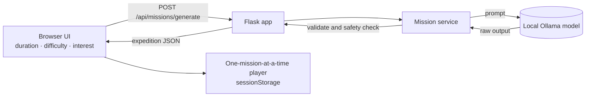

<div align="center">

# 🌿 Nature Saathi

### *Your phone is the map. The world is the classroom.*

**An AI-powered outdoor learning companion that turns an ordinary walk into a real-world nature expedition.**

<<<<<<< HEAD


-1f2937)


=======
- Python 3.9 or newer
- Ollama running locally, with the configured text model available
- Pillow (installed automatically via `requirements.txt`) for image validation
>>>>>>> 6d9061f (fix: improve Nature Saathi evidence and Ollama handling)

[Quick Start](#-quick-start) · [How It Works](#-how-it-works) · [API](#-mission-generation-api) · [Tests](#-tests) · [Roadmap](#-roadmap)

</div>

---

## 🧭 What is Nature Saathi?

*Saathi* (साथी) means **companion**. Most apps want your eyes on the screen. Nature Saathi wants them on the **sky, the soil, and the sparrow on the wall**.

Pick how long you have, how adventurous you feel, and what you're curious about. A **local AI model** writes a custom expedition for you. You read one mission, **put the phone away, go explore, come back**, and tap complete.

> 📱 **The screen should be the shortest part of the experience.**

---

## 🎮 The Expedition Loop

```text
   ┌───────────┐     ┌───────────┐     ┌───────────┐     ┌───────────┐
   │  1. PICK  │ ──▶ │  2. READ  │ ──▶ │ 3. EXPLORE│ ──▶ │ 4. RETURN │
   │ time, mood│     │ one short │     │ phone away│     │ mark it   │
   │ & interest│     │  mission  │     │ eyes up!  │     │ complete  │
   └───────────┘     └───────────┘     └───────────┘     └─────┬─────┘
         ▲                                                      │
         └──────────── next mission / review discoveries ◀──────┘
```

---

## ✨ Features

| | Feature | What it means for you |
|---|---|---|
| 🎯 | **Tailored expeditions** | Choose duration, difficulty, and interest (e.g. *Birds*) and get a fresh mission list. |
| 🧠 | **Local AI via Ollama** | Missions are generated on your own machine. No cloud AI account needed. |
| 🚶 | **One mission at a time** | Focused, phone-light flow with a progress indicator and a completion action. |
| 🔄 | **Refresh-proof runs** | Your active expedition is kept in the tab's `sessionStorage`, so an accidental refresh won't lose it. |
| 🔍 | **Review What I Discovered** | Revisit the prompts you completed once you're back. |
| 🛡️ | **Safety-aware output** | Every expedition includes a safety note, and unsafe model output is rejected. |
| 🔒 | **Private by design** | No personal notes, no uploads, no database. Closing the tab clears everything. |

---

## 🚀 Quick Start

**You need:** Python 3.9+ and [Ollama](https://ollama.com) running locally.

### 1. Get the AI ready

```bash
ollama pull gemma3:4b     # default model
ollama list               # confirm it's installed
```

### 2. Run the app

<details open>
<summary><b>🪟 Windows (PowerShell)</b></summary>

```powershell
python -m venv .venv
.venv\Scripts\Activate.ps1
python -m pip install -r requirements.txt
Copy-Item .env.example .env
python app.py
```
</details>

<details>
<summary><b>🍎 macOS / 🐧 Linux</b></summary>

```bash
python3 -m venv .venv
source .venv/bin/activate
python -m pip install -r requirements.txt
cp .env.example .env
python app.py
```
</details>

### 3. Step outside (almost)

| Where | URL |
|---|---|
| 🌍 The app | http://127.0.0.1:5000 |
| 💚 Health check | http://127.0.0.1:5000/api/health |

<<<<<<< HEAD
---
=======
### Optional: Local Vision Analysis

Photo evidence can be analyzed by a local vision model to provide informational descriptions. Set `OLLAMA_VISION_MODEL` in `.env` to configure which model handles analysis:

```env
OLLAMA_VISION_MODEL=gemma3:4b
```

**Requirements**: The model must support image input. `gemma3:4b` supports vision natively — verify with:

```powershell
ollama show gemma3:4b
```

If the model does not support vision, or if Ollama is unavailable, vision analysis gracefully reports that it is unavailable and does not block photo evidence submission or mission completion.

## Photo Evidence Workflow

During an active expedition, each mission may require evidence before completion:

- **Photo missions**: The user selects or captures a photo (JPEG, PNG, or WebP, up to 10 MB), previews it, and submits it as evidence. A photo mission cannot be marked complete until photo evidence has been submitted successfully.
- **Reflection missions**: The user writes a short reflection about what they noticed. A reflection mission cannot be marked complete until a non-empty reflection has been submitted.
- **Optional missions**: No evidence is required; the user can mark the mission complete directly.

### Privacy and Temporary Photo Storage

Photo data is kept in browser memory only for the active expedition. Photo bytes, Base64 strings, data URLs, and object URLs are never written to `localStorage` or `sessionStorage`. Photos are not saved to a database or disk. Photos are not sent to external APIs, third-party image services, cloud AI services, or analytics. Only the local Flask/Ollama setup is used for optional image analysis.

On page refresh, the expedition progress is recovered from `sessionStorage`, but photo evidence for the current active mission must be reselected (photos are never persisted). Reflection text is preserved across refreshes. When the expedition ends or the page session closes, all photo references are released.

### Vision Analysis Results

When vision analysis succeeds, the result includes:

- **Description**: A neutral description of what is visibly present.
- **Possible identification**: A suggested identification, when appropriate.
- **Observation**: A short observation or learning point.
- **Uncertainty**: A note about ambiguity or uncertainty in the identification.

Vision analysis is informational only. It is not proof that a mission was completed. Model output is treated as an untrusted suggestion, not verified fact. The app never claims an exact species identification without adequate evidence, and never tells users that an unfamiliar plant, mushroom, insect, or animal is safe to touch or eat.

## Mission generation API
>>>>>>> 6d9061f (fix: improve Nature Saathi evidence and Ollama handling)

## ⚙️ Configuration

Copy `.env.example` to `.env` and adjust.

| Setting | Notes |
|---|---|
| `OLLAMA_MODEL` | Defaults to `gemma3:4b`. Set it to any locally installed text model. |
| `FLASK_DEBUG` | Set to `true` for **local development only**. |
| Host binding | The dev server binds to `127.0.0.1` by default, so it stays on your machine. |

---

## 🧩 How It Works



The mission service validates everything the model returns. Malformed, incomplete, or unsafe output never reaches the page.

---

## 🔌 Mission Generation API

### `POST /api/missions/generate`

**Request**

```json
{
  "duration_minutes": 45,
  "difficulty": "Explorer",
  "interest": "Birds"
}
```

**Success response** returns an expedition object with:

<<<<<<< HEAD
- `title`, `theme`, `duration_minutes`, `difficulty`
- `intro` and `safety_note`
- a list of `missions`, each with:

| Field | Purpose |
|---|---|
| `id` | Unique mission identifier |
| `title` | Short, catchy name |
| `task` | What to go and do |
| `observation_cue` | What to look, listen, or feel for |
| `learning_note` | The "aha" fact to take home |
| `evidence_type` | How you'll know you found it |
| `difficulty` | Mission difficulty |
=======
## Evidence API

`POST /api/evidence/photo` accepts multipart form data with a `file` field. Returns `200` on success, `400` for invalid images, `413` for oversized files.

`POST /api/evidence/reflection` accepts JSON with a `text` field. Returns `200` on success, `400` for empty or invalid reflections.

`POST /api/vision/analyze` accepts multipart form data with a `file` field. Returns `200` with analysis results, or `200` with `status: "unavailable"` if vision analysis is not available.

## Running Tests
>>>>>>> 6d9061f (fix: improve Nature Saathi evidence and Ollama handling)

**Errors** always use one shape:

```json
{ "error": { "code": "...", "message": "..." } }
```

| Status | Meaning |
|---|---|
| `400` | Invalid request |
| `503` | Ollama is unavailable |
| `502` | Model output was malformed, incomplete, or unsafe |

---

## 🗂️ Project Map

```text
nature-saathi/
├── app.py            # Flask entry point and routes
├── config.py         # Environment-driven settings
├── prompts/          # Prompt templates for the model
├── services/         # Mission generation and validation
├── templates/        # HTML pages
├── static/           # Frontend JS and CSS
├── tests/            # Python and Node test suites
├── .env.example      # Copy to .env
└── requirements.txt
```

---

## 🧪 Tests

Dependency-light, so no heavy test frameworks to install.

```bash
# Mission service checks
python -m unittest discover -s tests -v

# Frontend behavior (mocked DOM)
node tests/test_frontend_render.js
```

<<<<<<< HEAD
The frontend test covers **mission navigation, progress, completion, refresh recovery, and malformed mission data**. It is a logic check and does not replace a visual browser test.

---

## 🔐 Privacy Promise

- ✅ Runs against a **local** model
- ✅ Server binds to **localhost** by default
- ✅ State lives only in your **current tab**
- ❌ No accounts · ❌ No database · ❌ No uploads · ❌ No personal notes stored

---

## 🛠️ Troubleshooting

<details>
<summary><b>I get a 503 error when generating a mission</b></summary>

Ollama isn't reachable. Make sure it's running and the model exists: `ollama list`. If not, run `ollama pull gemma3:4b` or set `OLLAMA_MODEL` in `.env` to a model you have.
</details>

<details>
<summary><b>I get a 502 error</b></summary>

The model returned something that didn't pass validation (malformed, incomplete, or unsafe). Just try again, or switch to a more capable model via `OLLAMA_MODEL`.
</details>

<details>
<summary><b>My expedition vanished</b></summary>

Progress is stored per browser tab and cleared when the tab is closed. That's intentional for privacy.
</details>

---

## 🗺️ Roadmap

- [ ] Optional printable expedition cards, so you can leave the phone at home entirely
- [ ] More interest themes (trees, insects, clouds, night sky)
- [ ] Group and family expedition mode
- [ ] Multilingual missions (English, हिन्दी, and more)

*Ideas and contributions are welcome. Open an issue and say hello.*

---

## 🤝 Contributing

1. Fork the repo and create a branch
2. Make your change and run both test suites
3. Open a pull request describing what you improved

---

<div align="center">

**Built with 🌱 curiosity by [Shikha Shukla](https://github.com/Shikha18Shukla)**

*Now close the laptop. There's a bird out there waiting to be noticed.* 🐦

</div>
=======
The Python tests cover mission generation, evidence validation, vision analysis, and Flask endpoints. The frontend test uses a small mocked DOM to cover mission navigation, progress, completion, refresh recovery, and malformed mission data. It does not replace a visual browser test.

## Known Limitations

- Photo evidence must be reselected after a page refresh (by design, for privacy).
- Vision analysis requires a local Ollama model that supports image input.
- AI-generated identifications are informational only and should be verified with reliable field guides or experts.
- The frontend test's photo selection mock has limitations; the full photo flow should be tested in a real browser.
>>>>>>> 6d9061f (fix: improve Nature Saathi evidence and Ollama handling)
